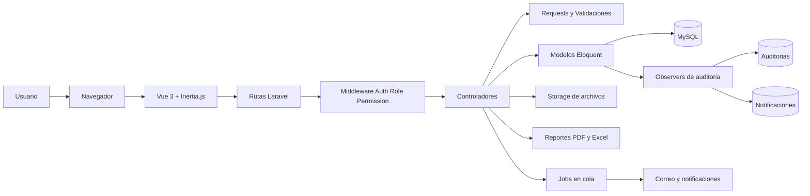
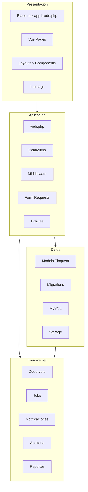
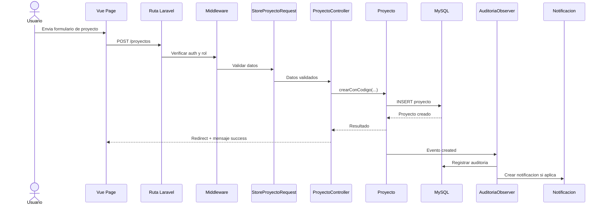
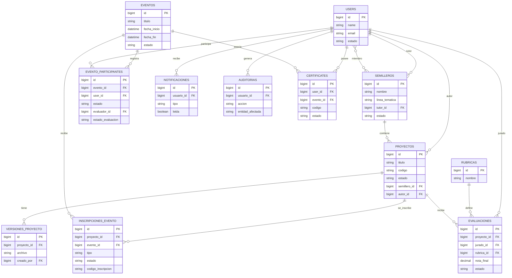
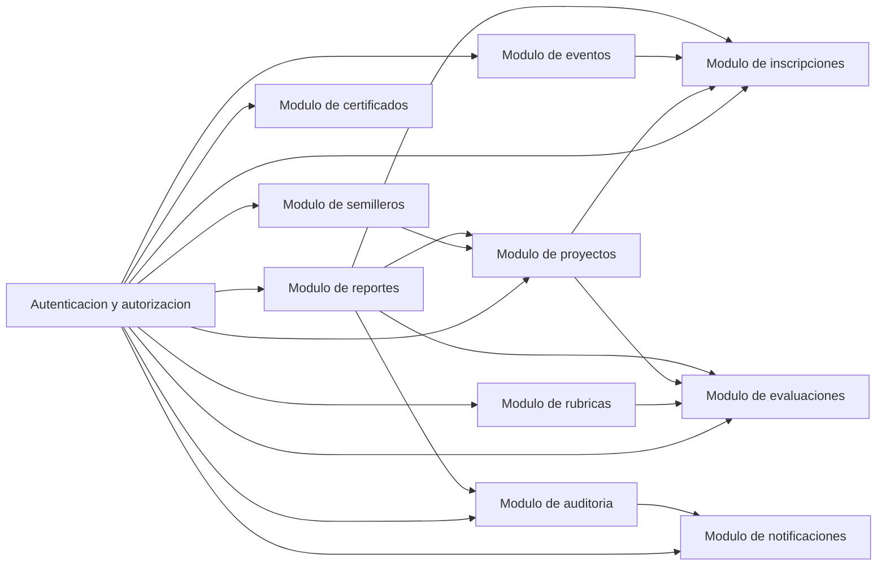

# DIAGRAMAS DE ARQUITECTURA PARA TESIS

Este documento contiene diagramas en Mermaid listos para copiar en la tesis, exportar como imagen o convertir a PDF. Los diagramas fueron elaborados con base en la estructura real del proyecto.

## 1. Diagrama general de arquitectura

### Lectura recomendada

- El usuario interactua desde el navegador.
- Vue 3 e Inertia gestionan la presentacion sin separar el frontend en otro despliegue.
- Laravel centraliza rutas, middleware, controladores y acceso a datos.
- La base de datos MySQL persiste la informacion principal.
- Existen servicios transversales para storage, auditoria, notificaciones, colas y reportes.

## 2. Diagrama por capas

## 3. Flujo de una solicitud tipica

El siguiente diagrama modela un caso real: crear un proyecto.

## 4. Diagrama entidad-relacion resumido

## 5. Diagrama de modulos funcionales

## 6. Fuente tecnica de los diagramas

Los diagramas se sustentan en los siguientes archivos del proyecto:

- `composer.json`
- `package.json`
- `bootstrap/app.php`
- `routes/web.php`
- `app/Http/Controllers/`
- `app/Models/`
- `app/Providers/AppServiceProvider.php`
- `app/Observers/AuditoriaObserver.php`
- `database/migrations/`

## 7. Como convertir estos diagramas en evidencia visual

Opciones recomendadas:

1. Copiar el bloque Mermaid a [Mermaid Live Editor](https://mermaid.live/) y exportarlo como PNG o SVG.
2. Pegarlo en GitHub, Obsidian, Typora o VS Code con extension Mermaid para renderizarlo.
3. Exportar el diagrama como imagen y usarlo directamente en el capitulo de arquitectura o en anexos.

## 8. Recomendacion de uso en la tesis

- Usa el diagrama general de arquitectura en el capitulo de diseno o arquitectura.
- Usa el diagrama por capas en la seccion metodologica o de construccion.
- Usa el DER resumido en el capitulo de base de datos.
- Usa el diagrama de flujo de solicitud para explicar un caso de uso critico.
- Usa el diagrama de modulos funcionales para mostrar el alcance del sistema.
